# Práctica Docker Desktop: contenedores efímeros

**Alumno:** Miguel Nicolas Mateo Blanco Soto

**Fecha:** 06/11/2026

---

## Preparación del entorno

Abrí Docker Desktop y utilizamos su misma terminal para todos los comandos

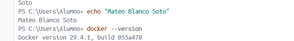

---

## Parte 1: Ejecutar el primer contenedor y observar su ciclo de vida

### 1.1. Ejecución y descarga

`docker run hello-world` ya que docker run no encontro la imagen llamada hello-word, la crea y arranca un contenedor

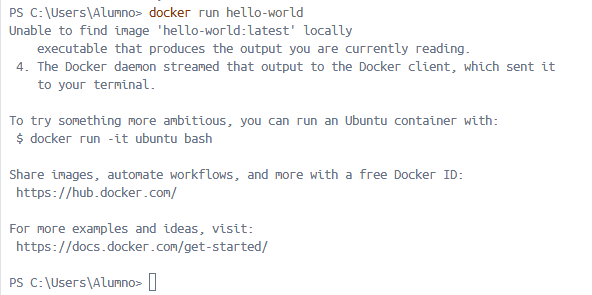

### 1.2. Reflexión

**¿Qué mensaje aparece?**
Aparece `Hello from Docker!` seguido de: *"This message shows that your installation appears to be working correctly"*, lo que confirma que Docker Desktop funciona correctamente.

**Acciones que Docker reporta haber realizado:**
1. Descargar: no tenía la imagen en local, así que la descargó de Docker Hub.
2. Ejecutar: el daemon creó un contenedor y ejecutó el programa que produce el mensaje.
3. Salir: al terminar el mensaje vuelve el prompt, lo que indica que el contenedor acabó.

**¿Dónde reside la imagen? ¿Se ha eliminado?**
Queda guardada en el almacén local de Docker. No se elimina al terminar
el contenedor, como se ve en la Captura 7, donde `hello-world` sigue en la lista.

**¿Sigue "vivo" o terminó? ¿Cuál es el estado final?**
Finalizó sin errores.

### 1.3. Verificación del contenedor detenido

`docker ps` lista los contenedores, pero por defecto solo los que están activos

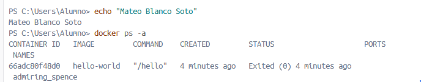

**Anotaciones (copia los valores de tu captura):**
- **CONTAINER ID:** `66adc80f48d0`
- **STATUS:** `Exited (0) 4 minutes ago`
- **NAMES:** `admiring_spence` (asignado por Docker)

---

## Parte 2: Nombrar contenedores para una mejor gestión

### 2.1. Ejecutar con nombre personalizado

Docker run --name saludo1 hello-world es el mismo contenedor, pero con `--name saludo1` le asignamos un nombre elegido por nosotros.

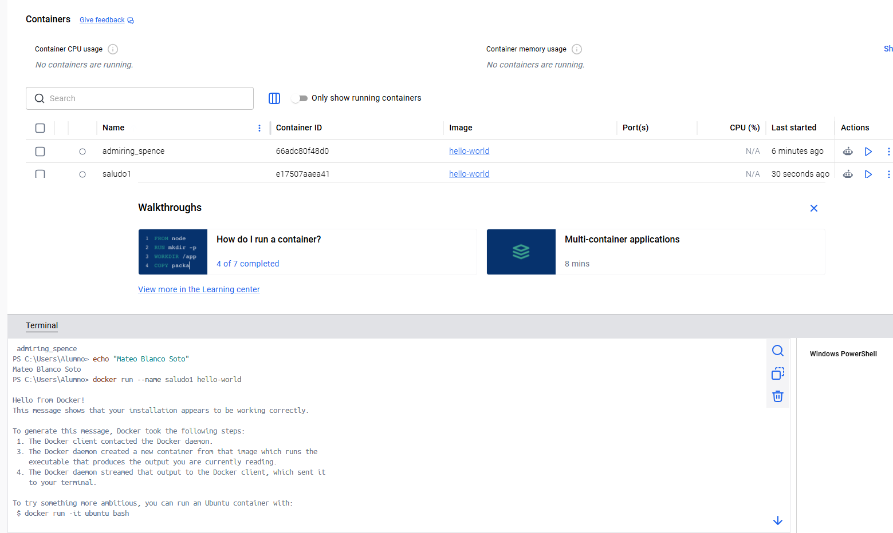

### 2.2. Verificación

Con docker ps -a listamos todos los contenedores para comprobar que `saludo1` aparece con el nombre que le hemos dado.

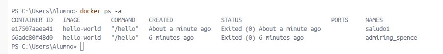

### 2.3. Reflexión

**¿Qué diferencias notas en la columna NAMES?**
El contenedor de la Parte 1 tiene un nombre aleatorio generado por Docker, mientras que el nuevo se llama exactamente `saludo1`.

**¿Por qué es útil asignar un nombre?**
- Es más fácil de recordar y escribir que un ID de 12 caracteres o un nombre aleatorio.
- Permite identificar de un vistazo para qué sirve cada contenedor.
- Reduce errores al eliminar, parar o inspeccionar el contenedor equivocado.
- Se puede usar en scripts y comandos de forma predecible, porque el nombre es fijo.

---

## Parte 3: Limpieza de contenedores detenidos

### 3.1. Eliminación por nombre

 `docker rm` elimina un contenedor que no esta activo

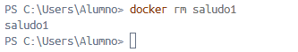

### 3.2. Verificación de la eliminación

Con docker ps -a listamos de nuevo todos los contenedores para comprobar que `saludo1` ya no aparece.

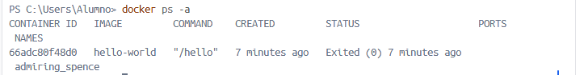

### 3.3. Paso extra: eliminar el contenedor de la Parte 1

Eliminamos tambien el primer contenedor

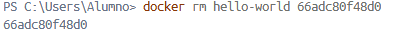

---

## Parte 4: Limpieza de imágenes

### 4.1. Listar imágenes locales

Docker images muestra las imágenes que tenemos en el equipo

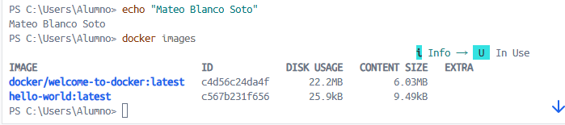

### 4.2. Eliminación de la imagen

 `docker rmi` elimina una imagen local indicando su nombre o ID. 
 
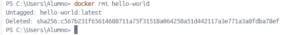

### 4.3. Verificación final

Con docker images comprobamos que `hello-world` ya no está en la lista de imágenes locales.

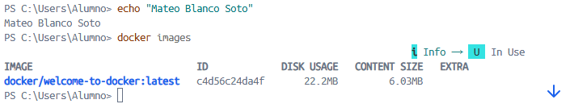

### 4.4. Reflexión

**¿Cuál es la diferencia fundamental entre `docker rm` y `docker rmi`? ¿Qué elimina cada uno?**
- `docker rm` elimina **contenedores** (las instancias, en ejecución o detenidas, creadas a partir de una imagen).
- `docker rmi` elimina **imágenes** (las plantillas de solo lectura a partir de las cuales se crean los contenedores).

**¿Qué ocurriría si ahora intentaras ejecutar `docker run hello-world` de nuevo?**
Como la imagen ya no está en local, Docker volvería a mostrar, la descargaría otra vez desde Docker Hub y después crearía un contenedor nuevo, con otro nombre aleatorio, y lo ejecutaría, mostrando de nuevo 

